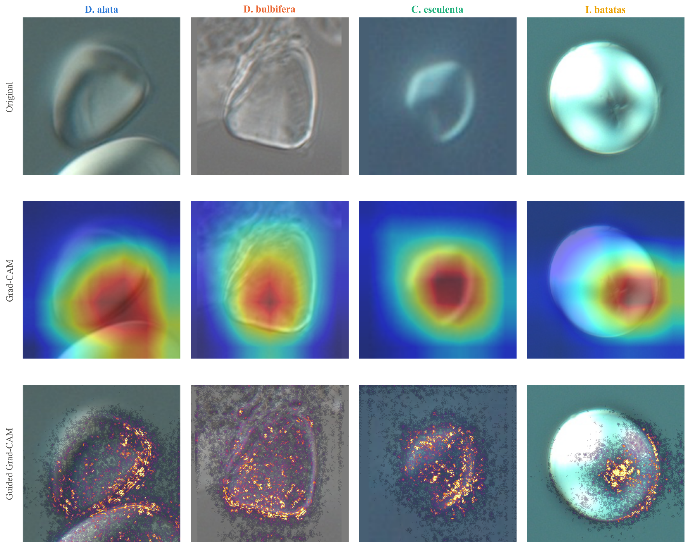

# Starch granule species classification & Grad-CAM

## Table of Contents

- [Project Description](#project-description)
- [Results](#results)
- [How to Install and Run the Project](#how-to-install-and-run-the-project)
- [How to Use the Project](#how-to-use-the-project)
- [Repo Layout](#repo-layout)
- [Credits](#credits)

## Project Description

This project classifies starch granules from microscope photos of yam (*Dioscorea*) and
related tuber crop sections by species, and uses Grad-CAM to check *why* it gets those
classifications right — i.e., whether it's actually looking at granule morphology, or
picking up on something incidental like background or lighting.

**Why these technologies:**
- **ResNet18 (ImageNet-pretrained)** — the dataset is ~3,000
  crops across 4 species works better with a CNN.
- **CellSAM for granule detection** — a segmentation model, run tile-by-tile over
  each full-resolution photo, to localize individual granules without hand-tuned
  thresholding per species.
- **StratifiedGroupKFold grouped by source photo** — Grouping by source photo lowers risk of the model memorize photo-specific background instead of granule shape.
- **Grad-CAM / Guided Grad-CAM** — Guided Grad-CAM gives a pixel-level preview of what the model looks at.

**Challenges faced:**
- Class sizes are uneven across species (as few as ~500 granules, up to ~800, per fold),
  so training uses per-species class weighting.

**Future features:**
- Expanding species coverage as more specimens become available.

## Results

5-fold stratified cross-validation, grouped by source photo, across 4 species (D. alata,
D. bulbifera, C. esculenta, I. batatas) and 3,094 granule crops:

| Metric | Mean ± std |
|---|---|
| Per-granule accuracy | 92.3% |
| Balanced accuracy | 93.7% ± 1.4% |
| Specimen-level accuracy (pooled probabilities) | 100% |

Full per-fold numbers in [`results/granule_classifier/results.csv`](results/granule_classifier/results.csv).

One correctly-classified granule per species: the original crop, the coarse Grad-CAM
heatmap (red = region the prediction came from), and the sharper Guided Grad-CAM saliency
(brighter = specific pixels that drove it):



## How to Install and Run the Project

Two conda environments are used, since CellSAM (crop extraction) and the training stack
have conflicting dependencies. Each script's first line (`# conda env: ...`) says which one
it needs.

**`starch_vit`** — manifest building, dataset cleanup, training, Grad-CAM, figures:

```
conda create -n starch_vit python=3.10
conda activate starch_vit
pip install torch torchvision scikit-learn matplotlib Pillow numpy
```

**`starch_cellsam`** — per-granule detection/cropping (`build_granule_crops.py`,
`cellsam_tiled.py`):

```
conda create -n starch_cellsam python=3.10
conda activate starch_cellsam
pip install cellSAM opencv-python Pillow numpy
```

Install a CUDA build of `torch`/`torchvision` matching your GPU if you want GPU-accelerated
training; both environments fall back to CPU otherwise.

## How to Use the Project

Run each step from `src/`, in order, switching conda environments as noted — each step's
output feeds the next:

```
conda activate starch_vit
python find_near_duplicates.py      # writes near_duplicates.csv
python build_manifest.py            # writes manifest.csv

conda activate starch_cellsam
python build_granule_crops.py       # writes crops/<species>/ and granule_manifest.csv

conda activate starch_vit
python filter_fragments.py          # cleans crops/ and granule_manifest.csv in place
python clean_scalebar_crops.py      # cleans crops/ and granule_manifest.csv in place
python train_granule_classifier.py  # writes results/granule_classifier/results.csv
python grad_cam.py                  # writes outputs/grad_cam/
python guided_grad_cam.py           # writes outputs/guided_grad_cam/
python make_gradcam_figure.py       # writes results/granule_classifier/figures/4_guided_gradcam.png
```

`find_near_duplicates.py` and `build_manifest.py` expect raw microscope photos on disk;
point `src/paths.py` at that data directory (or set the `STARCH_DATA_ROOT` environment
variable) before running them. Every later step only needs the manifests and crops those
first two steps produce.

## Repo Layout

```
manifest.csv              deduplicated image list
granule_manifest.csv      per-granule crop list, linked back to source image
near_duplicates.csv       near-duplicate image clusters
crops/<species>/          padded per-granule crop images
results/granule_classifier/
  results.csv             per-fold and mean/std accuracy
  figures/                Guided Grad-CAM summary figure
src/
  paths.py                     DATA_ROOT / REPO_ROOT config
  find_near_duplicates.py      near-duplicate scan
  build_manifest.py            manifest builder
  cellsam_tiled.py             tiled CellSAM wrapper, used by build_granule_crops.py
  build_granule_crops.py       per-granule crop extraction
  filter_fragments.py          crop quality filter
  clean_scalebar_crops.py      crop quality filter
  granule_dataset.py           GranuleDataset
  granule_model.py             GranuleResNetClassifier
  train_granule_classifier.py  training + cross-validation
  grad_cam.py                  Grad-CAM
  guided_grad_cam.py           Guided Grad-CAM, imports grad_cam.py
  make_gradcam_figure.py       summary figure
```

## Credits

- [vanvalenlab/cellsam](https://github.com/vanvalenlab/cellsam) — CellSAM, the cell/granule
  segmentation foundation model used for granule detection.
- [pytorch/vision](https://github.com/pytorch/vision) — torchvision, source of the
  ImageNet-pretrained ResNet18 backbone.
- [scikit-learn/scikit-learn](https://github.com/scikit-learn/scikit-learn) — `StratifiedGroupKFold`
  cross-validation.
